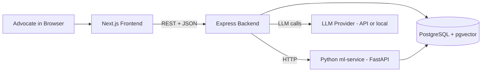
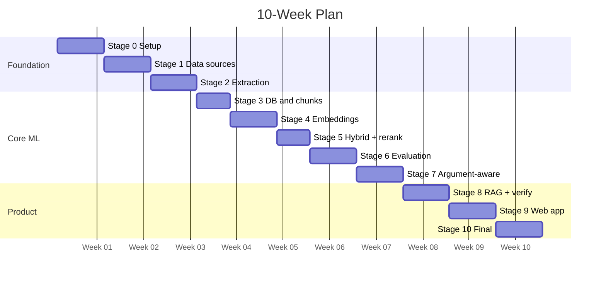
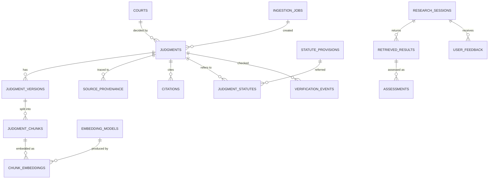

# Implementation Plan
## Semantic Retrieval and Argument-Aware Ranking of Indian Legal Precedents

> **How to read this file:** The project is divided into **11 Stages (0–10)**. A **Stage** is a big chapter of work (about one week). Each Stage is split into small **Phases** (about half a day to two days each). Every Phase has a checkbox, so you always know what is done and how much of a Stage is left.

---

## 0. How to Use This Plan

### 0.1 The tracking system

There are three levels of tracking:

| Level | What it is | How you track it |
|---|---|---|
| **Project** | The whole 10-week project | The **Master Dashboard** (Section 2) |
| **Stage** | A big chapter (e.g., "Embeddings & Semantic Retrieval") | The **Phase tracker** at the top of every Stage |
| **Phase** | One small task (e.g., "Create the HNSW vector index") | One checkbox `- [ ]` → change to `- [x]` when finished |

**Rule for ticking a phase:** you may tick a Phase **only when its "Done when" condition is true**. If you cannot show the proof (a screenshot, a test passing, a file existing), it is not done.

**How to compute progress:** `Stage progress = ticked phases ÷ total phases in that Stage`. Example: 5 of 8 phases ticked = 62%. Update the Master Dashboard once at the end of each working day.

### 0.2 Status symbols

| Symbol | Meaning |
|---|---|
| ⬜ | Not started |
| 🟨 | In progress |
| ✅ | Complete (all phases ticked, milestone reached) |
| ⚠️ | Behind schedule, read the "If you fall behind" box in that Stage |

### 0.3 The structure of every Stage

Every Stage has the same sections, so you always know where to look:

1. **Objective:** what this Stage achieves, in one or two sentences.
2. **Why this Stage exists:** what breaks later if you skip it.
3. **Concepts you must understand first:** plain-English explanations.
4. **Phase tracker:** the checklist.
5. **Phase details:** for each Phase: *What*, *Why*, *Steps*, *Done when*, *How to test*, *Common errors*.
6. **Stage exit checklist and milestone:** a checkpoint before you move on.
7. **If you fall behind:** what to cut.
8. **Viva checkpoint:** questions you should now be able to answer.

### 0.4 Golden rules for the whole project

1. **Never invent** case names, citations, quotes, paragraph numbers, statistics, or results. Every legal fact shown by the app must come from a stored document.
2. **Verify before you rely.** Read a data source's current terms before downloading from it.
3. **Small and verified beats big and unverified.** A clean corpus of a few hundred judgments is better than thousands of broken ones.
4. **One milestone at a time.** Do not start Stage N+1 until Stage N's exit checklist is complete.
5. **Measure, do not claim.** You do not know your system's accuracy until you evaluate it. Report whatever you measure, good or bad.
6. **Commit often.** At the end of every Phase, make a Git commit. At the end of every Stage, make a Git tag (`m0`, `m1`, …).
7. **Keep a decision log.** Whenever you choose something (a model, a chunk size, a library), write one line in `docs/decision-log.md` explaining why. This becomes your viva defence.

---

## 1. Decisions Made on Your Behalf (Change Them If Needed)

You gave a complete project description but did not specify a few practical details. I made these assumptions so the plan is concrete. **If any is wrong, tell me and I will adjust the plan.**

| # | Decision | Chosen value | Why |
|---|---|---|---|
| D1 | Court in the initial corpus | **Supreme Court of India only** | One court means one hierarchy and one open dataset. High Courts come later. |
| D2 | Legal domain | **Employment / service law: wrongful dismissal, misconduct, domestic enquiry, natural justice** | It matches your running example. It has plenty of case law with real disagreement, so supporting and adverse cases both exist. |
| D3 | Corpus size | **About 300–600 judgments** after filtering | Enough for meaningful retrieval experiments, small enough to inspect, label, and run on a laptop. |
| D4 | Primary data source | **AWS Open Data: "Indian Supreme Court Judgments"** | Bulk download is permitted, CC-BY-4.0 licensed, and includes PDFs plus metadata (verified in Stage 1). |
| D5 | Team size | **1 student** | The plan has "if you fall behind" boxes in every Stage. |
| D6 | Hardware | **Ordinary laptop, no GPU required**, 8 GB RAM minimum, 16 GB recommended | Small embedding models and a small reranker run on CPU. |
| D7 | Where retrieval code lives | **Python `ml-service`** | The evaluation scripts and the live app must run the *same* retrieval code (see Section 1.1). |
| D8 | LLM | **Pluggable provider**: a free-tier API *or* a local open-weight model (Ollama) | Never hard-wire one provider. Free-tier limits change, so check them at build time. |
| D9 | Authentication | **Simple login added in Stage 9 only if time remains**; the prototype may run single-user | Authentication is production work, not research work. Plan the hooks, do not build all of it. |

### 1.1 The most important architecture decision: who does what

Your original stack had Node.js for the backend and Python for ML. Here is the exact split. It prevents duplicated logic and keeps your experiments honest.



| Component | Owns | Does NOT do |
|---|---|---|
| **Next.js frontend** | Pages, forms, display of results, source viewer | Any legal logic, any database access |
| **Express backend** | HTTP API, request validation (Zod), saving sessions and feedback, calling the LLM, orchestrating the research pipeline, error handling | Embeddings, ranking, classification |
| **Python ml-service** | Embeddings, hybrid retrieval, reranking, argument-aware classifier, quote verification | User sessions, HTTP API for the browser |
| **PostgreSQL + pgvector** | Judgments, chunks, vectors, full-text index, sessions, assessments, feedback | |

**Why retrieval lives in Python (defend this in your viva):** your evaluation experiments (Stage 6) are written in Python. If the live app used a *different* implementation of retrieval (say, rewritten in JavaScript), then the numbers you measured would describe a system that is not the one you demonstrate. Having one implementation used by both guarantees that *what you evaluate is what you ship*.

### 1.2 Components that are essential vs. later

| Essential (build in 10 weeks) | Add later (stretch or future scope) |
|---|---|
| PostgreSQL + pgvector + full-text search | Redis + BullMQ queue (a simple script is enough for ingestion) |
| Python ingestion script (batch) | Automatic scheduled corpus updates |
| Dense + keyword + hybrid retrieval + reranker | Fine-tuned embedding model |
| Argument-aware classifier (baselines + one stronger model) | Full learning-to-rank with many features |
| LLM explanation grounded in passages | Multi-court coverage (High Courts, tribunals) |
| Quote and paragraph verification | Citator (tracking overruled or distinguished cases) |
| Basic web app with saved sessions | Production auth, roles, audit trail |

---

## 2. Master Dashboard

**Update this table every day.** Fill the "Done" column with the number of ticked phases.

| Stage | Name | Target week | Phases | Done | Progress | Status |
|---|---|---|---|---|---|---|
| 0 | Setup and Foundations | Week 1 | 8 | 0 | 0% | ⬜ |
| 1 | Data Source Verification and Corpus Acquisition | Week 2 | 8 | 0 | 0% | ⬜ |
| 2 | Text Extraction, Cleaning and Metadata | Week 3 | 9 | 0 | 0% | ⬜ |
| 3 | Database, Ingestion and Chunking | Week 4 | 8 | 0 | 0% | ⬜ |
| 4 | Embeddings and Semantic Retrieval | Weeks 4–5 | 7 | 0 | 0% | ⬜ |
| 5 | Keyword, Hybrid Retrieval and Reranking | Week 5 | 7 | 0 | 0% | ⬜ |
| 6 | Evaluation Dataset and Retrieval Experiments (A, B) | Week 6 | 9 | 0 | 0% | ⬜ |
| 7 | Query Understanding and Argument-Aware Analysis (C) | Week 7 | 9 | 0 | 0% | ⬜ |
| 8 | RAG, LLM Integration and Citation Verification | Week 8 | 9 | 0 | 0% | ⬜ |
| 9 | Full Web Application | Week 9 | 9 | 0 | 0% | ⬜ |
| 10 | Testing, Ablation (D), Security, Report and Demo | Week 10 | 9 | 0 | 0% | ⬜ |
| | **TOTAL** | 10 weeks | **92** | **0** | **0%** | |

### 2.1 Milestones

| Milestone | Reached when | Tag |
|---|---|---|
| **M0** | Frontend, backend, ml-service and database all start and talk to each other | `m0` |
| **M1** | Data sources verified; raw Supreme Court PDFs and a provenance manifest exist | `m1` |
| **M2** | Clean, paragraph-segmented text for the full corpus, with a quality report | `m2` |
| **M3** | Judgments and chunks are in PostgreSQL with correct schema | `m3` |
| **M4** | Semantic search returns sensible results for probe queries | `m4` |
| **M5** | Hybrid retrieval and reranking work behind one `/retrieve` endpoint | `m5` |
| **M6** | Evaluation set exists; Experiments A and B are run and tabulated | `m6` |
| **M7** | Argument-aware classifier trained and evaluated | `m7` |
| **M8** | End-to-end pipeline works from the command line with verified citations | `m8` |
| **M9** | Complete web application works end to end | `m9` |
| **M10** | Tests pass, ablation done, report and demo ready | `m10` |

### 2.2 Weekly calendar at a glance



*(The dates are placeholders. Change them to your real calendar. Stages 3–5 overlap in weeks 4–5.)*

---

## 3. Target Folder Structure (Create It in Stage 0)

Keep it simple. One repository (a "monorepo"), no extra microservices.

```
legal-precedent-discovery/
├── README.md                      # How to install and run everything
├── docker-compose.yml             # PostgreSQL + pgvector
├── .env.example                   # Template of environment variables (no secrets)
├── .gitignore
│
├── apps/
│   ├── web/                       # Next.js + TypeScript + Tailwind frontend
│   │   ├── app/                   # Pages (landing, research, judgment, sessions, coverage)
│   │   ├── components/            # ResultCard, FilterPanel, SourceViewer, ...
│   │   └── lib/api.ts             # Typed functions that call the backend
│   │
│   ├── api/                       # Express + TypeScript backend
│   │   ├── src/
│   │   │   ├── index.ts           # Server start
│   │   │   ├── routes/            # research.ts, judgments.ts, courts.ts, coverage.ts, feedback.ts
│   │   │   ├── services/          # llm/, mlClient.ts, researchPipeline.ts
│   │   │   ├── middleware/        # validate.ts, errorHandler.ts
│   │   │   └── db.ts              # PostgreSQL connection
│   │   └── tests/
│   │
│   └── ml-service/                # Python FastAPI service (all ML logic)
│       ├── app/
│       │   ├── main.py            # /health, /embed, /retrieve, /rerank, /classify, /verify
│       │   ├── retrieval/         # dense.py, keyword.py, fusion.py, rerank.py, orchestrator.py
│       │   ├── classify/          # features.py, baselines.py, predict.py
│       │   └── verify/            # quotes.py, paragraphs.py
│       └── tests/
│
├── packages/
│   └── shared/                    # Zod schemas + TypeScript types shared by web and api
│
├── pipeline/                      # OFFLINE ingestion scripts (run by hand, not by the web app)
│   ├── 01_download.py             # Download from the verified source
│   ├── 02_extract_text.py         # PDF -> text (+ OCR fallback)
│   ├── 03_clean_segment.py        # Cleaning + paragraph segmentation
│   ├── 04_normalise_metadata.py
│   ├── 05_load_db.py              # Insert into PostgreSQL
│   ├── 06_chunk.py
│   ├── 07_embed.py
│   └── qa_report.py               # Extraction quality report
│
├── db/
│   └── migrations/                # 001_core.sql, 002_chunks.sql, ...
│
├── data/                          # NOT committed to Git (large)
│   ├── raw/                       # Original PDFs and metadata, never edited
│   ├── interim/                   # Extracted text
│   └── manifest.csv               # Provenance record (this IS committed)
│
├── evaluation/
│   ├── queries.jsonl              # Your scenario queries
│   ├── qrels.jsonl                # Relevance labels (query, judgment, grade)
│   ├── argument_labels.jsonl      # Argument-aware labels (proposition, passage, label)
│   ├── metrics.py                 # Recall@K, Precision@K, MRR, nDCG@K
│   ├── run_experiments.py
│   └── results/                   # Tables and plots from actual runs
│
├── notebooks/                     # Exploration only
└── docs/
    ├── decision-log.md
    ├── data-source-verification.md
    ├── annotation-guidelines.md
    ├── limitations.md
    └── report/
```

**What goes in Git:** code, migrations, small evaluation files, the manifest, docs. **What does not:** raw PDFs, extracted text, model files, `.env`.

---

# STAGE 0: Setup and Foundations

**Target:** Week 1  |  **Phases:** 8  |  **Milestone:** M0

## Objective
Have every part of the system (database, Python service, Express API, Next.js app) running on your laptop and talking to each other, with a clean Git repository.

## Why this Stage exists
Almost every "mysterious" bug in later weeks (wrong Python version, database not starting, ports clashing) is really a setup bug. Fixing them now, when nothing depends on them, costs hours. Fixing them in week 8 costs days.

## Concepts you must understand first

**Monorepo.** One Git repository that contains several apps (frontend, backend, ML service). It means one `git clone` gives you everything.

**Port.** A numbered "door" on your computer where a program listens. We will use: frontend `3000`, backend `4000`, ml-service `8000`, PostgreSQL `5432`.

**Environment variable.** A setting (like a database password) kept *outside* the code in a `.env` file, so secrets never reach GitHub.

**Docker (in one sentence).** A tool that runs a program (here: PostgreSQL with pgvector pre-installed) in an isolated box, so you do not need to install and configure it manually.

**REST API.** The frontend asks the backend for things by sending HTTP requests (`GET /api/health`) and receives JSON back.

## Phase tracker (Stage 0): progress: 0 / 8
- [ ] 0.1 Freeze scope and start the decision log
- [ ] 0.2 Install the toolchain
- [ ] 0.3 Create the GitHub repository and folder skeleton
- [ ] 0.4 Start PostgreSQL with pgvector in Docker
- [ ] 0.5 Create the Python environment and ml-service skeleton
- [ ] 0.6 Create the Express backend with a health check and validated config
- [ ] 0.7 Create the Next.js frontend and connect it to the backend
- [ ] 0.8 One-command startup, README, first tag (M0)

## Phase details

### Phase 0.1: Freeze scope and start the decision log
- **What:** Write down, in `docs/decision-log.md`, the decisions D1–D9 from Section 1 (or your changed versions).
- **Why:** Scope creep kills student projects. A written scope is something you can point to when you are tempted to add "just one more court."
- **Steps:**
  1. Create `docs/decision-log.md`.
  2. For each decision write: date, decision, alternatives considered, reason.
  3. Add a section **"Out of scope for the 10-week prototype"** listing: High Courts, tribunals, citator, production authentication, automatic updates.
- **Done when:** the file exists with at least D1–D9 and the out-of-scope list.
- **How to test:** Ask someone to read it. Can they say what the project will *not* do?
- **Common errors:** Writing a vague scope ("legal AI"). Write something checkable: "Supreme Court of India, employment and service law, about 300–600 judgments."

### Phase 0.2: Install the toolchain
- **What:** Install and verify every tool.
- **Required tools and check commands:**

| Tool | Version to aim for | Check command |
|---|---|---|
| Git | any recent | `git --version` |
| Node.js | 20 LTS or newer | `node --version` |
| npm | comes with Node | `npm --version` |
| Python | 3.10 or newer (3.11 is a good choice) | `python --version` |
| Docker Desktop | recent | `docker --version` |
| VS Code | recent | open it |
| Tesseract OCR (for Stage 2) | 5.x | `tesseract --version` |

- **Steps:** Install each; run the check command; paste the output into `docs/setup-notes.md`.
- **Done when:** all check commands print versions without errors.
- **Common errors:**
  - `python` not found on Windows → try `py --version`, or reinstall Python with "Add to PATH" ticked.
  - Docker says "virtualisation disabled" → enable virtualisation in BIOS or use WSL2 on Windows.
  - Tesseract installed but not found → add its install folder to PATH. It can wait until Stage 2.

### Phase 0.3: Create the GitHub repository and folder skeleton
- **What:** Create the repo and the empty folders from Section 3.
- **Steps:**
  1. Create an empty GitHub repository named `legal-precedent-discovery`.
  2. `git clone` it, `cd` into it.
  3. Create the folders (they can contain a `.gitkeep` file so Git tracks them).
  4. Create `.gitignore` containing at least:
     ```
     node_modules/
     .env
     data/raw/
     data/interim/
     __pycache__/
     .venv/
     .next/
     *.pt
     *.bin
     ```
  5. Create `.env.example` (empty for now).
  6. Commit: `git commit -m "chore: initial project skeleton"`; push.
- **Done when:** the repository on GitHub shows the folder structure.
- **How to test:** clone it into a different folder; the structure is identical.
- **Common errors:** committing `node_modules` or `.env`. If it happens, remove it from history *immediately* and rotate any secret that was exposed.

### Phase 0.4: Start PostgreSQL with pgvector in Docker
- **What:** Run a PostgreSQL database that has the `pgvector` extension.
- **Why:** pgvector adds a `vector` column type and fast similarity search to ordinary PostgreSQL, so one database holds judgments, text, vectors and sessions.
- **Steps:**
  1. Create `docker-compose.yml`:
     ```yaml
     services:
       db:
         image: pgvector/pgvector:pg16
         container_name: legal_db
         environment:
           POSTGRES_USER: legal
           POSTGRES_PASSWORD: legal_dev_password
           POSTGRES_DB: legal_precedents
         ports:
           - "5432:5432"
         volumes:
           - pgdata:/var/lib/postgresql/data
     volumes:
       pgdata:
     ```
  2. Run `docker compose up -d`.
  3. Connect: `docker exec -it legal_db psql -U legal -d legal_precedents`.
  4. Inside psql run: `CREATE EXTENSION IF NOT EXISTS vector;` then `SELECT '[1,2,3]'::vector;`.
- **Done when:** the last command prints `[1,2,3]`.
- **How to test:** stop and restart the container; your data is still there (that is what the `pgdata` volume does).
- **Common errors:**
  - "port 5432 already in use" → another PostgreSQL is installed on your machine. Change the left side of the port mapping to `5433:5432` and use port 5433 everywhere.
  - `extension "vector" is not available` → you used a plain `postgres` image. Use the `pgvector/pgvector` image.
- **Note:** this dev password is fine for a laptop only. It must never be used on a server.

### Phase 0.5: Create the Python environment and ml-service skeleton
- **What:** A virtual environment plus a tiny FastAPI app with a `/health` endpoint.
- **Steps:**
  1. `cd apps/ml-service`, then `python -m venv .venv`, activate it.
  2. Create `requirements.txt` with: `fastapi`, `uvicorn[standard]`, `psycopg[binary]`, `pgvector`, `numpy`, `pandas`, `pydantic`, `python-dotenv`. (More packages will be added per Stage.)
  3. `pip install -r requirements.txt`.
  4. Create `app/main.py`:
     ```python
     from fastapi import FastAPI

     app = FastAPI(title="Legal ML Service")

     @app.get("/health")
     def health():
         return {"status": "ok", "service": "ml-service"}
     ```
  5. Run `uvicorn app.main:app --reload --port 8000`.
- **Done when:** opening `http://localhost:8000/health` shows `{"status":"ok","service":"ml-service"}`. Also check `http://localhost:8000/docs`, which is FastAPI's automatic documentation page.
- **Common errors:** "No module named app" → you are not inside `apps/ml-service` when running uvicorn, or `app/__init__.py` is missing.

### Phase 0.6: Create the Express backend with a health check and validated config
- **What:** TypeScript Express server that exposes `GET /api/health` and checks that the database and ml-service are reachable.
- **Why Zod for config too:** if a required environment variable is missing, the server should refuse to start with a clear message, not crash mysteriously later.
- **Steps:**
  1. In `apps/api`: `npm init -y`, then install: `express cors zod pg dotenv`; dev: `typescript tsx @types/express @types/node @types/cors @types/pg`.
  2. Create `src/config.ts`:
     ```ts
     import { z } from "zod";
     import "dotenv/config";

     const Env = z.object({
       PORT: z.coerce.number().default(4000),
       DATABASE_URL: z.string().url(),
       ML_SERVICE_URL: z.string().url().default("http://localhost:8000"),
     });
     export const config = Env.parse(process.env);
     ```
  3. Create `src/index.ts`: an Express app with CORS enabled for `http://localhost:3000` and a `/api/health` route that runs `SELECT 1` on the database and calls `GET {ML_SERVICE_URL}/health`.
  4. Put real values in a local `.env` (not committed) and placeholder values in `.env.example`.
  5. Add an npm script: `"dev": "tsx watch src/index.ts"`.
- **Done when:** `GET http://localhost:4000/api/health` returns JSON such as `{"api":"ok","db":"ok","mlService":"ok"}`.
- **How to test:** stop the database container; the health route should report `"db":"down"` instead of crashing. Restart it; it reports `ok` again.
- **Common errors:** CORS error in the browser later → the frontend origin must be allowed in `cors()`. `ECONNREFUSED` → the other service is not running or the port is wrong.

### Phase 0.7: Create the Next.js frontend and connect it to the backend
- **What:** A Next.js (TypeScript, Tailwind, App Router) app with one page that displays the health status fetched from the backend.
- **Steps:**
  1. From the repo root: `npx create-next-app@latest apps/web` (choose TypeScript, Tailwind, App Router).
  2. Create `apps/web/lib/api.ts` with a function `getHealth()` that calls `NEXT_PUBLIC_API_URL + "/api/health"`.
  3. In `.env.local` (inside `apps/web`): `NEXT_PUBLIC_API_URL=http://localhost:4000`.
  4. On the home page, call `getHealth()` and show three green/red status dots: API, Database, ML service.
- **Done when:** the home page at `http://localhost:3000` shows three green dots.
- **How to test:** stop ml-service; its dot turns red. Restart; green.
- **Common errors:** "Failed to fetch" → backend not running or CORS. Environment variable not picked up → restart `npm run dev` after editing `.env.local`; variables seen by the browser must start with `NEXT_PUBLIC_`.

### Phase 0.8: One-command startup, README, first tag (M0)
- **What:** Make it easy for you (and a teammate or examiner) to start everything.
- **Steps:**
  1. In the root `package.json`, add scripts using `concurrently` (or a simple `Makefile`/shell script) that start: db (`docker compose up -d`), ml-service, api, web.
  2. Write `README.md`: prerequisites, setup commands, how to start, how to check health, ports.
  3. Commit, then `git tag m0` and push the tag.
- **Done when:** a fresh clone plus the README steps gets all three green dots, without help from you.
- **How to test:** ask a friend, or delete your local copy and re-follow your own README.

## Stage 0 exit checklist
- [ ] Three green dots on the home page.
- [ ] `docs/decision-log.md` exists.
- [ ] `m0` tag pushed.
- [ ] README tested from scratch.

## If you fall behind
Skip Docker for the database *only if it cannot be made to work* and use a managed free PostgreSQL that supports pgvector. Do not skip the health-check chain. Drop Tailwind styling polish; plain HTML is fine.

## Viva checkpoint
- Why are there three separate services instead of one?
- Why does the retrieval code live in Python rather than in Express?
- What does Zod do for configuration?

---

# STAGE 1: Data Source Verification and Corpus Acquisition

**Target:** Week 2  |  **Phases:** 8  |  **Milestone:** M1

## Objective
Verify, in writing, which legal data you are allowed to use, then download a small raw Supreme Court corpus together with a record of where every file came from.

## Why this Stage exists
Data access is your project's biggest risk. A beautiful retrieval system on data you are not allowed to use, or cannot trace to a source, is not defensible. Doing this early also tells you whether the project is feasible at all.

## Concepts you must understand first

**Free access is not permission.** A website being visible to everyone does not mean you may download all of it, store it, index it, or redistribute it. Always check: (1) is automated access allowed, (2) is bulk download allowed, (3) what licence applies, (4) is attribution required, (5) is research or commercial use allowed.

**Provenance.** For every document: where it came from (URL), when you got it, and a fingerprint of the exact file (a SHA-256 hash). If a judgment shows up in your results, you can always trace it back to its source.

**SHA-256 hash.** A short fixed-length code computed from a file's bytes. If even one byte changes, the hash changes. It detects corruption and duplicates.

**Official vs third-party vs community source.**
- *Official:* the court itself (Supreme Court of India, eCourts, India Code).
- *Third-party:* a company or individual that republishes (Indian Kanoon, commercial APIs).
- *Community dataset:* a researcher or volunteer group that collected official data and shared it (the AWS Open Data datasets).

## What I verified for you (as of the day this plan was written)

> **You must re-check each item yourself in Phase 1.2–1.3. Websites and terms change. Record the date you checked.**

| Source | What I found | Plan |
|---|---|---|
| **AWS Open Data: Indian Supreme Court Judgments** (`s3://indian-supreme-court-judgments`, managed by Dattam Labs) | Registry entry lists judgments from **1950 to 2025**, with raw metadata in JSON and structured metadata in Parquet, English and regional-language PDFs, **CC-BY-4.0 licence**, bi-monthly updates, and public access without an AWS account. Documentation is in the `vanga/indian-supreme-court-judgments` GitHub repository. Its text states the judgments were downloaded from the eCourts website. | **Primary source.** Attribution (CC-BY-4.0) must appear in your app's "About/Coverage" page and report. |
| **AWS Open Data: Indian High Court Judgments** (same maintainer) | Exists, also sourced from eCourts. The excerpt I saw did not show its licence, so **I could not confirm it**. | Out of scope now. If you add High Courts later, read its registry page and licence first. |
| **Indian Kanoon API** | Documented API with search, document, document-fragment and metadata endpoints. It uses **prepaid per-request pricing** (search ₹0.50, document ₹0.20, fragment ₹0.05, metainfo ₹0.02). New accounts get ₹500 test credit; the pricing page says **non-commercial use may get free ₹10,000 monthly credit but needs use-case verification** by the site administrator. Its terms require **attribution**, state "best efforts" availability, and say that products using the data for RAG or fine-tuning must show attribution prominently. | **Optional supplement**, not a dependency. Useful for spot-checking a document against a second source. |
| **Third-party commercial APIs** (several were listed in a 2026 comparison article) | Pricing and coverage claims are made by the vendors themselves, and the comparison article was written by one of the vendors. | **Do not rely on these.** Treat their claims as unverified marketing. |
| **Community metadata dataset on Hugging Face** (KanoonGPT "Indian Case Laws") | Says it holds structured *metadata* for SC and about 25 High Courts, built from the same AWS releases. | Metadata only. Not needed. |
| **eCourts Judgments portal / Supreme Court website** (official) | I did **not** verify their automated-access terms. | **Do not scrape.** Use only through the AWS dataset unless you read and accept their current terms. |
| **India Code** (legislation) | I did **not** verify its terms. | Read the terms before using. For the prototype, store the *names and section numbers* of statutes only. Do not bulk-copy statute text unless the terms allow. |

**Important consequence of the above:** your corpus's *legal reliability* is limited by two things: the dataset is a community copy of eCourts data (so it can contain gaps or errors), and the PDFs are not edited by lawyers. The app must say so on its Coverage page.

## Phase tracker (Stage 1): progress: 0 / 8
- [ ] 1.1 Create the data-source verification sheet
- [ ] 1.2 Verify the primary source (AWS Supreme Court dataset)
- [ ] 1.3 Verify the secondary sources and write verdicts
- [ ] 1.4 Download and inspect the metadata
- [ ] 1.5 Explore the metadata and choose years
- [ ] 1.6 Download the English PDFs for the chosen years
- [ ] 1.7 Create the provenance manifest (URL, date, SHA-256, licence)
- [ ] 1.8 Storage budget and sanity check, tag M1

## Phase details

### Phase 1.1: Create the data-source verification sheet
- **What:** A template in `docs/data-source-verification.md` that you fill in for every source.
- **Template (copy for each source):**
  ```
  Source name:
  URL checked:                     Date checked:
  Who runs it (official / third-party / community):
  What it provides (full text / PDF / metadata / API):
  Court and date coverage (as stated by the source):
  Automated access allowed?  (quote the sentence)
  Bulk download allowed?     (quote the sentence)
  Licence:
  Attribution required:
  Research use allowed?      Commercial use allowed?
  Rate limits / cost:
  Known quality issues:
  VERDICT: use / use with conditions / do not use
  ```
- **Done when:** the template is in the file.

### Phase 1.2: Verify the primary source (AWS Supreme Court dataset)
- **What:** Read the primary sources yourself and fill the sheet.
- **Steps:**
  1. Open the registry page `https://registry.opendata.aws/indian-supreme-court-judgments/`.
  2. Open its documentation link (`docs/dataset.md` in the GitHub repository `vanga/indian-supreme-court-judgments`).
  3. Write down: licence, update frequency, folder layout, metadata fields, years covered, citation text, contact.
  4. Run the anonymous listing command: `aws s3 ls --no-sign-request s3://indian-supreme-court-judgments/` (needs the AWS CLI, with no account needed). If you do not want to install the AWS CLI, you can use the public `https://indian-supreme-court-judgments.s3.amazonaws.com/...` links shown in the repository documentation.
  5. Note the attribution you must display (CC-BY-4.0 requires crediting the creator, giving the licence link, and indicating changes).
- **Done when:** the sheet for this source is complete with *quoted* sentences, not paraphrases from memory.
- **Common errors:** "AccessDenied" → you forgot `--no-sign-request`.

### Phase 1.3: Verify the secondary sources and write verdicts
- **What:** Fill the sheet for: eCourts Judgments portal, Supreme Court website, Indian Kanoon (site and API terms), India Code.
- **Steps:** For each, read the terms or "robots/usage" statements. Fill every field. If you cannot find an explicit permission, the verdict is **"do not use for bulk collection."**
- **Fallback strategy to write in the sheet:**
  1. Primary: AWS dataset (bulk, licensed).
  2. If AWS becomes unavailable: use the copy you already downloaded (that is why we keep raw files and hashes).
  3. If you need more data: apply for Indian Kanoon API access under its non-commercial route and use it *only* within its terms.
  4. If nothing works: reduce scope to the judgments you already have and say so honestly in the report.
- **Done when:** every source has a verdict and a date.

### Phase 1.4: Download and inspect the metadata
- **What:** Download only the *metadata* first (small) before any PDFs.
- **Why:** Metadata tells you how many judgments exist per year and what fields you get, so you can plan before downloading gigabytes.
- **Steps:**
  1. Create `pipeline/01_download.py`.
  2. Download the metadata index/Parquet for a few candidate years, following the dataset's documented layout.
  3. Save under `data/raw/metadata/`. Never edit raw files.
  4. Load with pandas: `df = pd.read_parquet(...)`; print `df.columns`, `df.shape`, `df.head()`.
- **Done when:** you can list the metadata columns and the number of judgments per year.
- **Common errors:** Layout differs from what you expect. Trust the dataset's own documentation, not this plan.

### Phase 1.5: Explore the metadata and choose years
- **What:** Decide *which years* to download.
- **Why:** We cannot filter by legal subject yet (the subject is inside the text). So choose a small set of years, extract their text in Stage 2, and filter by domain there.
- **Steps:**
  1. Count judgments per year (use the real counts from your metadata).
  2. Check for missing titles, dates, or missing PDF links.
  3. Choose **2–4 years** so the total is a few thousand PDFs at most. Prefer a mix: one older year, one recent, so you see layout variety. Avoid the most recent incomplete year.
  4. Write the choice and reason in the decision log.
- **Done when:** the decision log has "Years chosen: …, because …".
- **Tip:** Your final corpus is the **employment/service-law subset** of these years. Pick years so that the subset can reach roughly 300–600 judgments. If it turns out too small after filtering in Stage 2, add one more year then.

### Phase 1.6: Download the English PDFs for the chosen years
- **What:** Get the actual judgment PDFs.
- **Steps:**
  1. Extend `01_download.py` to fetch each chosen year's English judgments (the documentation shows a per-year tar archive and individual PDFs).
  2. Be polite: download the tar archives (fewer requests) rather than thousands of individual files, and add a small delay if you do fetch individual files.
  3. Extract to `data/raw/pdfs/<year>/`.
  4. Make the script **resumable**: skip files that already exist.
- **Done when:** PDFs exist in `data/raw/pdfs/<year>/` and the file count roughly matches the metadata count.
- **How to test:** open five PDFs by hand and confirm they are readable.
- **Common errors:** interrupted download → resumable script solves it. Disk full → check space first (Phase 1.8).

### Phase 1.7: Create the provenance manifest
- **What:** A CSV listing every file with its source and hash.
- **Columns:** `file_id, year, local_path, source_url, retrieved_at, sha256, size_bytes, licence, attribution, source_dataset_version_or_date`.
- **Steps:**
  1. Write a script that walks `data/raw/pdfs/`, computes SHA-256 for each file, and writes `data/manifest.csv`.
  2. Detect **exact duplicates**: two files with the same hash. Mark them.
- **Done when:** `data/manifest.csv` has one row per PDF, no empty hash cells.
- **How to test:** pick 3 rows, recompute the hash by hand (`sha256sum file.pdf`), compare.
- **Why committed to Git:** the manifest is small and is your proof of origin. The PDFs themselves are not committed.

### Phase 1.8: Storage budget and sanity check, tag M1
- **What:** Know your numbers before moving on.
- **Steps:**
  1. Compute total PDF size: `du -sh data/raw`.
  2. Record: total files, total GB, free disk space.
  3. Manually open 10 random PDFs. Note: Are they text-based or scanned images? Do they have numbered paragraphs? Any non-English pages?
  4. Update `docs/data-source-verification.md` and the decision log; commit; `git tag m1`.
- **Done when:** the notes contain actual numbers and your observations.

## Stage 1 exit checklist
- [ ] Verification sheet complete with verdicts and dates.
- [ ] CC-BY attribution text prepared for the app and the report.
- [ ] Raw PDFs and metadata downloaded, unmodified.
- [ ] `data/manifest.csv` with hashes.
- [ ] `m1` tag pushed.

## If you fall behind
Reduce to **one year** of PDFs. If the download is slow, download just the metadata plus one year's tar archive. Do not scrape other sites to compensate.

## Viva checkpoint
- Why did you choose this dataset over scraping the official portal?
- What does CC-BY-4.0 require of you?
- What is provenance and why does a legal system need it?
- Why is a "smaller verified dataset" better here?

---

# STAGE 2: Text Extraction, Cleaning and Metadata

**Target:** Week 3  |  **Phases:** 9  |  **Milestone:** M2

## Objective
Turn raw PDFs into clean, trustworthy text that is split into **numbered paragraphs**, with normalised metadata, and filter the result down to your employment/service-law corpus.

## Why this Stage exists
Everything downstream (search, ranking, quoting, paragraph citations) is only as good as this text. If paragraph 14 in your database is not paragraph 14 in the judgment, the whole "verifiable source-grounded" claim collapses. This is the least glamorous and most important Stage.

## Concepts you must understand first

**Judgments are not ordinary text.** A typical Supreme Court judgment contains: case title, case number(s), bench (judges), date, sometimes a headnote, then the body: facts, arguments of each side, issues, reasoning, and the final order. Paragraphs are usually numbered (`1.`, `2.`, …). Judges cite statutes (`Article 311`, `Section 25F`) and earlier cases.

**Text-based PDF vs scanned PDF.** A text-based PDF stores real characters; extraction is easy. A scanned PDF is just pictures of pages; you need **OCR** (Optical Character Recognition) to read them. Older judgments are more likely scanned.

**Cleaning must not destroy legal meaning.** Unlike a sentiment-analysis project, you must **not** remove: negations ("not", "no"), numbers, section/article references, citations, punctuation inside citations, or case-sensitive abbreviations. "Not guilty" and "guilty" are opposite results.

**Idempotent script.** Running it twice produces the same result and does not break anything. Make all pipeline scripts idempotent.

## Phase tracker (Stage 2): progress: 0 / 9
- [ ] 2.1 Read five judgments by hand and write a structure note
- [ ] 2.2 Extract text from PDFs with PyMuPDF
- [ ] 2.3 Detect bad extractions (empty, garbled, scanned)
- [ ] 2.4 Add OCR fallback for scanned PDFs
- [ ] 2.5 Clean the text without destroying legal content
- [ ] 2.6 Segment into numbered paragraphs
- [ ] 2.7 Normalise metadata (title, date, court, bench, case number)
- [ ] 2.8 Filter to the employment/service-law domain and remove duplicates
- [ ] 2.9 Extraction quality report and manual audit (M2)

## Phase details

### Phase 2.1: Read five judgments by hand and write a structure note
- **What:** Open five different PDFs (different years) and study their layout.
- **Why:** Your regexes and rules must come from what real documents look like, not from guesses.
- **Steps:** For each judgment note: where the title is; where the date is; how paragraphs are numbered (`1.`, `(1)`, `1)`); header/footer text that repeats on each page; where the order/final decision is; whether there are page numbers or watermarks; any language mixing.
- **Done when:** `docs/judgment-structure-notes.md` has your observations for 5 judgments.
- **Tip:** This note will also help you in your report's "Data description" section.

### Phase 2.2: Extract text from PDFs with PyMuPDF
- **What:** `pipeline/02_extract_text.py`: PDF → one `.txt` (or JSON) file per judgment.
- **Why PyMuPDF:** fast and accurate for text-based PDFs. (`pdfplumber` is a fallback for tricky layouts.)
- **Steps:**
  1. `pip install pymupdf`.
  2. Core code:
     ```python
     import fitz  # PyMuPDF

     def extract_pages(pdf_path):
         doc = fitz.open(pdf_path)
         pages = []
         for i, page in enumerate(doc):
             pages.append({"page": i + 1, "text": page.get_text("text")})
         return pages
     ```
  3. Save results to `data/interim/text/<file_id>.json` with `{"file_id", "n_pages", "pages": [...], "extractor": "pymupdf"}`.
  4. Keep the **page number** with each page's text. It is useful for the source viewer.
  5. Make it resumable (skip existing outputs) and log failures to `data/interim/extract_errors.csv`.
- **Done when:** every PDF has either an output JSON or a logged error.
- **How to test:** compare the extracted text of 3 PDFs with what you see on screen. Word order and numbering should match.
- **Common errors:** two-column layouts interleave lines → use `page.get_text("blocks")` and sort blocks. Strange characters (`�`) → font encoding problem; treat as "bad extraction" in Phase 2.3.

### Phase 2.3: Detect bad extractions (empty, garbled, scanned)
- **What:** Automatic quality checks that label each document `ok`, `suspect`, or `needs_ocr`.
- **Checks (compute for every document):**

| Signal | Rule of thumb (tune on your data) | Meaning |
|---|---|---|
| Characters per page | very low (e.g., under ~200 on most pages) | Probably scanned → needs OCR |
| Share of non-alphabetic junk characters | high | Garbled |
| Share of `�` replacement characters | above ~0.5% | Encoding trouble |
| English dictionary-word ratio | low | Garbled or non-English |
| Very short total length | under a few hundred words | Truncated or an order-only document |

- **Done when:** `data/interim/quality.csv` has one row per document with the signals and the label.
- **How to test:** manually look at 5 `ok`, 5 `suspect`, 5 `needs_ocr` documents. Do the labels match reality? Adjust the thresholds.
- **Why this matters:** "missing or corrupted text" is something you must be able to *detect*, not just hope for.

### Phase 2.4: Add OCR fallback for scanned PDFs
- **What:** For documents labelled `needs_ocr`, convert pages to images and run Tesseract.
- **Steps:**
  1. Install Tesseract (Stage 0) and `pytesseract`, `pdf2image` (needs Poppler) *or* use PyMuPDF's `page.get_pixmap(dpi=300)` to render.
  2. For each page: render → `pytesseract.image_to_string(img, lang="eng")`.
  3. Save with `"extractor": "tesseract"` so you always know which text came from OCR.
  4. OCR is slow. Process only the `needs_ocr` set and use a limited number of documents.
- **Done when:** every `needs_ocr` document has OCR text (or is marked `unrecoverable`).
- **How to test:** read an OCR page; check numbers and section references. OCR often confuses `1`/`l`, `0`/`O`.
- **Policy decision (write in the decision log):** *OCR text is lower trust.* If a judgment's OCR confidence is poor, either exclude it from the corpus or mark it `ocr_low_quality` and display a warning. For a student project, **excluding** the worst few is acceptable if you document how many you excluded.
- **Common errors:** Tesseract not found → PATH problem. Very slow → lower DPI to 200–250, or skip OCR for this prototype's documents that are not in the domain subset (filter first, OCR later; see Phase 2.8 note).

### Phase 2.5: Clean the text without destroying legal content
- **What:** Remove *only* noise.
- **Remove or fix:**
  - Repeated page headers/footers (detect lines that appear on most pages, such as a reportable-notice line or a page counter).
  - Page-number-only lines.
  - Hyphenation at line ends (`dismis-\nsal` → `dismissal`).
  - Excess whitespace, broken line wraps inside a sentence.
- **Do NOT:** lowercase everything permanently, remove stop-words, strip punctuation, remove digits, remove "not"/"no", stem or lemmatise the stored text.
- **Steps:** Write `clean_text(pages) -> str` as small testable functions. Keep **both** `raw_text` and `clean_text`.
- **Done when:** unit tests pass: (a) negation survives, (b) `Article 311(2)` survives intact, (c) `Section 25-F` survives, (d) hyphenation is fixed, (e) a header repeated on every page is removed once, not from the body.
- **Why keep raw:** if a cleaning bug is found later, you can re-clean without re-extracting.
- **Common errors:** deleting a "header" that is actually the start of the judgment body. Test on several documents.

### Phase 2.6: Segment into numbered paragraphs
- **What:** Split the clean text into paragraphs and keep each paragraph's **printed number** (e.g., `7`) and its **sequence index** (e.g., 7th block in the document).
- **Why both:** the printed number is what lawyers cite ("para 7"). The sequence index is a safe fallback when numbering is missing.
- **Approach (rule-based):**
  1. Find paragraph starts using a regex like `^\s*(\d{1,3})\s*[\.\)]\s+` at line start.
  2. Check that numbers increase roughly in sequence (1, 2, 3, …). Isolated jumps (e.g., a "1960." year at line start) are false positives; reject a candidate whose number does not follow the previous one closely.
  3. Text between two paragraph starts belongs to the earlier paragraph.
  4. Text before paragraph 1 is the **preamble** (title, bench, parties, sometimes a headnote), stored as `para_no = NULL, section_type = 'preamble'`.
  5. If a judgment has **no usable numbering**, fall back to blank-line-separated blocks, mark `numbering_reliable = false`, and **disable paragraph-number citation for that judgment** (cite the page instead).
- **Output (JSON):** `paragraphs: [{ "seq": 1, "para_no": "1", "text": "...", "page_start": 1, "page_end": 1 }, ...]` and `numbering_reliable: true/false`.
- **Optional heuristic (`section_type`):** tag each paragraph `facts / arguments / issues / reasoning / order` using cue phrases ("heard learned counsel", "the question that arises", "in the result", "appeal is dismissed"). This can be very rough. Label it as heuristic. It is useful for retrieval boosts but not required.
- **Done when:** for 20 random judgments, the number of detected paragraphs matches your count within a small tolerance, and the last paragraph is the order/conclusion.
- **How to test:** write a test that asserts paragraph numbers are strictly increasing and a spot-check script that prints para N text next to the PDF page number.
- **Common errors:** sub-paragraph numbering `(i)`, `(a)` misread as paragraph starts; numbered lists inside quotations; footnote numbers at line start.

### Phase 2.7: Normalise metadata (title, date, court, bench, case number)
- **What:** One consistent record per judgment.
- **Fields:** `title`, `petitioner/appellant`, `respondent`, `court` (= "Supreme Court of India"), `decision_date` (ISO format `YYYY-MM-DD`), `bench` (list of judges), `case_number(s)`, `citation(s)` if available, `language`, `source_url`, `file_id`.
- **Steps:**
  1. Take what the dataset's metadata gives you as the starting point.
  2. Parse missing fields from the text *only when the metadata lacks them*, and mark the origin: `field_source = 'dataset' | 'parsed' | 'missing'`.
  3. Convert dates to ISO; reject impossible dates (future dates, dates before the year of the file).
  4. Standardise the court name to a single canonical string.
- **Rule on citations:** do **not** invent or "complete" a citation (e.g., a journal citation like a law-report reference). If the dataset does not provide it, store `NULL` and display "citation not available in corpus." Use the case title, date and neutral identifier from the source.
- **Done when:** a validation script reports counts: how many judgments have each field present; zero invalid dates.
- **How to test:** print 10 random normalised records next to the PDF's first page.

### Phase 2.8: Filter to the employment/service-law domain and remove duplicates
- **What:** From all extracted judgments, keep those relevant to **employment, dismissal, misconduct and natural justice**.
- **Why filter after extraction:** the subject is inside the text, not in the metadata.
- **Steps:**
  1. Define a **scoring rule** with keywords and phrases and a threshold, for example weighted counts of: `dismissal`, `termination of service`, `domestic enquiry`, `misconduct`, `natural justice`, `show cause`, `Industrial Disputes Act`, `workman`, `retrenchment`, `Article 311`, `departmental proceedings`, `disciplinary authority`, `reinstatement`, `back wages`.
  2. Score each document; keep those above a threshold. Look at borderline cases by hand.
  3. **Deliberately include** judgments that *reject* the employee's claim. You need adverse authorities too. Check that your corpus is not accidentally only employee-friendly.
  4. **Duplicates:** remove exact duplicates (same SHA-256 from Stage 1) and near-duplicates (same case title + same date; or text similarity above a high threshold). Keep one and log the rest in `data/interim/dedup_log.csv`.
  5. Adjust until you have roughly **300–600** judgments. Record how many you started with, how many the filter kept, and how many were removed as duplicates.
- **Done when:** a final list `data/interim/corpus_v1.csv` exists, with reasons for inclusion.
- **How to test:** read the titles of 30 random included judgments (are they on topic?) and 30 random excluded ones (did you drop something relevant?).
- **Note:** this keyword filter is only used to *build the corpus*. It is not your retrieval method. Do not confuse the two in your report.
- **Honest limitation to record:** a keyword-built corpus has selection bias toward your keyword choices.

### Phase 2.9: Extraction quality report and manual audit (M2)
- **What:** Generate a summary and audit samples by hand.
- **Steps:**
  1. `pipeline/qa_report.py` outputs: number of PDFs, extracted OK, needs OCR, OCR'd, unrecoverable, excluded; average pages; paragraphs per document; percentage with reliable numbering; percentage with each metadata field.
  2. Audit **20 random judgments**. For each, confirm: title correct, date correct, paragraph count plausible, last paragraph is the order, 3 random paragraphs match the PDF.
  3. Write the error rate you observed ("3 of 20 had wrong paragraph splits") in `docs/data-quality.md`. This honest number goes into your report.
  4. Commit; `git tag m2`.
- **Done when:** `docs/data-quality.md` has real counts and your audit findings.

## Stage 2 exit checklist
- [ ] Clean paragraph-segmented text for every corpus judgment.
- [ ] Documents with unreliable numbering flagged.
- [ ] Normalised metadata with `field_source` recorded.
- [ ] Domain corpus list (~300–600) with duplicates removed and logged.
- [ ] Quality report and audit written.
- [ ] `m2` tag pushed.

## If you fall behind
Skip OCR and *exclude* scanned documents (document the count). Skip the `section_type` heuristic. Accept `numbering_reliable=false` for hard documents rather than perfecting the splitter. Reduce corpus to ~250.

## Viva checkpoint
- Why do we keep both raw and cleaned text?
- Why must we not remove stop-words or negations?
- How do you detect a corrupted extraction?
- How do you know paragraph numbers are correct?
- What bias could your domain filter introduce?

---

# STAGE 3: Database, Ingestion and Chunking

**Target:** Week 4  |  **Phases:** 8  |  **Milestone:** M3

## Objective
Design the PostgreSQL schema, load the corpus into it, split judgments into retrievable **chunks**, and build the keyword (full-text) index.

## Why this Stage exists
Retrieval works on *chunks*, not whole judgments, and every chunk must be traceable back to the exact paragraphs of the exact judgment. The schema is what makes verification, versioning and per-query assessment possible.

## Concepts you must understand first

**Why chunk?** An embedding model turns text into one vector. If you embed an entire 40-page judgment into one vector, the specific point you want (say, one paragraph about the right to be heard) is averaged away. So we divide each judgment into pieces around one idea. A *chunk* is typically a few consecutive paragraphs.

**Chunk design trade-off.**

| Too small | Too large |
|---|---|
| Loses context; "Hence the appeal fails" means nothing alone | Several topics mixed → vague vector; may exceed the model's token limit |

**Token.** A piece of a word that models read (roughly ¾ of a word). Models have a maximum number of tokens per input (often 512 for small embedding models). Chunks must fit.

**Overlap.** Repeating the last sentence or paragraph of one chunk at the start of the next, so an idea straddling a boundary is not lost. Use a small overlap (for example one paragraph or ~1–2 sentences). Keep **paragraph boundaries** wherever possible.

**Per-query assessment, not per-judgment label.** Whether a judgment "supports" or "opposes" depends on *the advocate's specific argument*. So we store assessments in a table linked to a research session, never as a permanent column on `judgments`.

**Embedding versioning.** An embedding is meaningful only with respect to the model that produced it. If you change the model, all vectors are invalid. So each stored vector records its model.

## Entity-relationship overview



## Phase tracker (Stage 3): progress: 0 / 8
- [ ] 3.1 Review the schema design and decide column details
- [ ] 3.2 Write the migration files
- [ ] 3.3 Run the migrations and test the constraints
- [ ] 3.4 Load courts, judgments, versions and provenance
- [ ] 3.5 Implement the chunking algorithm
- [ ] 3.6 Load chunks and build the full-text search index
- [ ] 3.7 Extract statutory references (regex) and store them
- [ ] 3.8 Ingestion job logging, idempotency and database tests (M3)

## Table reference (purpose, key columns, keys, indexes)

| Table | Purpose | Important columns | Keys | Important indexes |
|---|---|---|---|---|
| `courts` | List of courts and their hierarchy level | `id`, `name`, `level` (supreme/high/district/tribunal), `state` | PK `id` | unique `name` |
| `judgments` | One row per judgment (the "case") | `id`, `court_id`, `title`, `decision_date`, `bench`, `case_numbers`, `citation_text`, `language`, `numbering_reliable`, `current_version_id` | PK `id`; FK `court_id → courts` | `decision_date`; `court_id`; GIN on `title` tsvector |
| `judgment_versions` | Each time the text is (re)extracted or corrected | `id`, `judgment_id`, `clean_text`, `raw_text_path`, `extractor`, `text_sha256`, `created_at` | PK; FK `judgment_id` | `judgment_id` |
| `source_provenance` | Where the document came from | `judgment_id`, `source_name`, `source_url`, `retrieved_at`, `file_sha256`, `licence`, `attribution` | PK; FK `judgment_id` | `judgment_id`; unique `file_sha256` |
| `judgment_chunks` | Retrievable pieces | `id`, `judgment_id`, `version_id`, `chunk_index`, `text`, `para_start`, `para_end`, `page_start`, `page_end`, `section_type`, `token_count`, `tsv` | PK; FK `judgment_id`, `version_id` | unique (`version_id`,`chunk_index`); GIN on `tsv` |
| `embedding_models` | Registry of models used | `id`, `name`, `dimension`, `query_prefix`, `created_at` | PK | unique `name` |
| `chunk_embeddings` | Vector for a chunk under one model | `chunk_id`, `model_id`, `embedding vector(N)` | PK (`chunk_id`,`model_id`); FKs | HNSW on `embedding` |
| `citations` | Judgment A cites judgment B | `citing_id`, `cited_id`, `context_text`, `treatment` (nullable, e.g. followed/distinguished) | PK (`citing_id`,`cited_id`,`para_no`) | `cited_id` |
| `statute_provisions` | A statute section | `id`, `statute_name`, `section_label`, `jurisdiction`, `notes` | PK; unique (`statute_name`,`section_label`) | |
| `judgment_statutes` | Link judgments to provisions | `judgment_id`, `provision_id`, `para_no` | PK composite | `provision_id` |
| `ingestion_jobs` | Log of each pipeline run | `id`, `started_at`, `finished_at`, `status`, `n_ok`, `n_failed`, `notes` | PK | |
| `verification_events` | Every verification check performed | `id`, `judgment_id`, `check_type`, `result`, `details`, `created_at` | PK; FK | `judgment_id` |
| `research_sessions` | One advocate query | `id`, `user_id` (nullable), `case_description`, `structured_query` (JSON), `filters` (JSON), `forum_court`, `created_at` | PK | `created_at` |
| `retrieved_results` | Judgments returned for a session | `id`, `session_id`, `judgment_id`, `rank`, `scores` (JSON), `best_chunk_ids` | PK; FKs | (`session_id`,`rank`) |
| `assessments` | **Per-query** relation of a judgment to the proposition | `id`, `result_id`, `proposition_text`, `position` (supports/opposes/mixed/insufficient), `evidence` (JSON), `authority_level` (binding/persuasive/unknown), `verification_status`, `model_version`, `confidence` | PK; FK `result_id` | `result_id` |
| `user_feedback` | Advocate feedback | `id`, `session_id`, `result_id`, `rating`, `comment`, `created_at` | PK; FKs | |

## Phase details

### Phase 3.1: Review the schema design and decide column details
- **What:** Walk through the diagram and table reference above and finalise columns for *your* data.
- **Steps:**
  1. Draw the ERD (the Mermaid above is a starting point; paste it into a Mermaid viewer).
  2. For each table, write one sentence: "This table exists so that ___."
  3. Decide the embedding model's dimension **now** (Stage 4, Phase 4.2 will pick the model; the `vector(N)` size must match). Use `384` as the default (small models). If you pick a different model later, create a new migration.
- **Done when:** the ERD and the one-sentence purposes are in `docs/schema.md`.

### Phase 3.2: Write the migration files
- **What:** SQL files that create the tables. A **migration** is a numbered SQL file you run in order. It makes the database reproducible.
- **Files:** `db/migrations/001_core.sql`, `002_chunks.sql`, `003_research.sql`.
- **Sample `001_core.sql`:**
  ```sql
  CREATE EXTENSION IF NOT EXISTS vector;

  CREATE TABLE courts (
    id          SERIAL PRIMARY KEY,
    name        TEXT NOT NULL UNIQUE,
    level       TEXT NOT NULL CHECK (level IN ('supreme','high','district','tribunal')),
    state       TEXT
  );

  CREATE TABLE judgments (
    id                  BIGSERIAL PRIMARY KEY,
    court_id            INT NOT NULL REFERENCES courts(id),
    title               TEXT NOT NULL,
    decision_date       DATE,
    bench               TEXT[],
    case_numbers        TEXT[],
    citation_text       TEXT,                -- NULL when not in the source
    language            TEXT DEFAULT 'en',
    numbering_reliable  BOOLEAN NOT NULL DEFAULT TRUE,
    metadata_origin     JSONB,               -- which fields were dataset/parsed/missing
    current_version_id  BIGINT,
    created_at          TIMESTAMPTZ NOT NULL DEFAULT now()
  );
  CREATE INDEX idx_judgments_date  ON judgments(decision_date);
  CREATE INDEX idx_judgments_court ON judgments(court_id);

  CREATE TABLE judgment_versions (
    id            BIGSERIAL PRIMARY KEY,
    judgment_id   BIGINT NOT NULL REFERENCES judgments(id) ON DELETE CASCADE,
    clean_text    TEXT NOT NULL,
    extractor     TEXT NOT NULL,            -- 'pymupdf' | 'tesseract'
    text_sha256   TEXT NOT NULL,
    created_at    TIMESTAMPTZ NOT NULL DEFAULT now()
  );
  ALTER TABLE judgments
    ADD CONSTRAINT fk_current_version
    FOREIGN KEY (current_version_id) REFERENCES judgment_versions(id);

  CREATE TABLE source_provenance (
    id            BIGSERIAL PRIMARY KEY,
    judgment_id   BIGINT NOT NULL REFERENCES judgments(id) ON DELETE CASCADE,
    source_name   TEXT NOT NULL,
    source_url    TEXT,
    retrieved_at  TIMESTAMPTZ NOT NULL,
    file_sha256   TEXT NOT NULL UNIQUE,
    licence       TEXT,
    attribution   TEXT
  );
  ```
- **Sample `002_chunks.sql`:**
  ```sql
  CREATE TABLE judgment_chunks (
    id           BIGSERIAL PRIMARY KEY,
    judgment_id  BIGINT NOT NULL REFERENCES judgments(id) ON DELETE CASCADE,
    version_id   BIGINT NOT NULL REFERENCES judgment_versions(id) ON DELETE CASCADE,
    chunk_index  INT NOT NULL,
    text         TEXT NOT NULL,
    para_start   INT,         -- printed paragraph number, NULL if unreliable
    para_end     INT,
    seq_start    INT NOT NULL,-- sequence index (always available)
    seq_end      INT NOT NULL,
    page_start   INT,
    page_end     INT,
    section_type TEXT,        -- heuristic: facts/issues/reasoning/order/preamble
    token_count  INT,
    tsv          TSVECTOR GENERATED ALWAYS AS (to_tsvector('english', text)) STORED,
    UNIQUE (version_id, chunk_index)
  );
  CREATE INDEX idx_chunks_tsv      ON judgment_chunks USING GIN (tsv);
  CREATE INDEX idx_chunks_judgment ON judgment_chunks(judgment_id);

  CREATE TABLE embedding_models (
    id            SERIAL PRIMARY KEY,
    name          TEXT NOT NULL UNIQUE,    -- e.g. the model's repository name
    dimension     INT NOT NULL,
    query_prefix  TEXT,                    -- some models need a prefix on queries
    created_at    TIMESTAMPTZ NOT NULL DEFAULT now()
  );

  CREATE TABLE chunk_embeddings (
    chunk_id   BIGINT NOT NULL REFERENCES judgment_chunks(id) ON DELETE CASCADE,
    model_id   INT    NOT NULL REFERENCES embedding_models(id),
    embedding  vector(384) NOT NULL,       -- must equal the model's dimension
    PRIMARY KEY (chunk_id, model_id)
  );
  -- The vector index is created in Stage 4, AFTER the data is loaded.
  ```
- **Sample `003_research.sql` (assessments are per-session):**
  ```sql
  CREATE TABLE research_sessions (
    id                BIGSERIAL PRIMARY KEY,
    user_id           BIGINT,
    case_description  TEXT NOT NULL,
    structured_query  JSONB,
    filters           JSONB,
    forum_court       TEXT,
    pipeline_version  TEXT,
    created_at        TIMESTAMPTZ NOT NULL DEFAULT now()
  );

  CREATE TABLE retrieved_results (
    id            BIGSERIAL PRIMARY KEY,
    session_id    BIGINT NOT NULL REFERENCES research_sessions(id) ON DELETE CASCADE,
    judgment_id   BIGINT NOT NULL REFERENCES judgments(id),
    rank          INT NOT NULL,
    scores        JSONB,
    best_chunk_ids BIGINT[]
  );

  CREATE TABLE assessments (
    id                   BIGSERIAL PRIMARY KEY,
    result_id            BIGINT NOT NULL REFERENCES retrieved_results(id) ON DELETE CASCADE,
    proposition_text     TEXT NOT NULL,
    position             TEXT NOT NULL CHECK (position IN ('supports','opposes','mixed','insufficient')),
    authority_level      TEXT CHECK (authority_level IN ('binding','persuasive','unknown')),
    verification_status  TEXT NOT NULL DEFAULT 'unverified',
    evidence             JSONB,
    confidence           REAL,
    model_version        TEXT,
    created_at           TIMESTAMPTZ NOT NULL DEFAULT now()
  );

  CREATE TABLE user_feedback (
    id          BIGSERIAL PRIMARY KEY,
    session_id  BIGINT REFERENCES research_sessions(id) ON DELETE CASCADE,
    result_id   BIGINT REFERENCES retrieved_results(id) ON DELETE CASCADE,
    rating      INT CHECK (rating BETWEEN 1 AND 5),
    comment     TEXT,
    created_at  TIMESTAMPTZ NOT NULL DEFAULT now()
  );
  ```
- **Remaining tables** (`citations`, `statute_provisions`, `judgment_statutes`, `ingestion_jobs`, `verification_events`): write them yourself following the table reference. It is good practice.
- **Done when:** all migration files exist and are committed.

### Phase 3.3: Run the migrations and test the constraints
- **What:** Apply the SQL and prove the rules work.
- **Steps:**
  1. Run them in order: `docker exec -i legal_db psql -U legal -d legal_precedents < db/migrations/001_core.sql` (then 002, 003).
  2. Inspect: `\dt` lists tables; `\d judgment_chunks` shows columns and indexes.
  3. **Negative tests:** try inserting a judgment with a non-existent `court_id` (must fail); try an `assessments.position` of `'favourable'` (must fail because of the `CHECK`).
- **Done when:** all tables exist and both negative tests fail as expected.
- **Common errors:** `type "vector" does not exist` → the `CREATE EXTENSION vector` line did not run. Run it first.
- **Optional improvement:** use a migration tool (for example `node-pg-migrate`, or Python `yoyo`/`alembic`) so migrations are tracked automatically. Plain SQL files are fine for the prototype.

### Phase 3.4: Load courts, judgments, versions and provenance
- **What:** `pipeline/05_load_db.py` inserts the corpus.
- **Steps:**
  1. Insert the one court: "Supreme Court of India", level `supreme`.
  2. For each corpus judgment, in **one transaction**: insert into `judgments`, then `judgment_versions` (store `clean_text`), then set `current_version_id`, then `source_provenance` (from the manifest).
  3. Make it **idempotent**: before inserting, check whether `file_sha256` already exists in `source_provenance`; skip if so.
  4. Record an `ingestion_jobs` row at the start and update it at the end.
- **Done when:** `SELECT count(*) FROM judgments;` equals your corpus size, and every judgment has exactly one provenance row.
- **How to test:** run the script twice; the counts must not change the second time.
- **Common errors:** Unicode errors → open files with `encoding="utf-8"`; ensure the DB is UTF-8. A single bad record should not abort the whole run: catch the error, log it into the job notes, continue.

### Phase 3.5: Implement the chunking algorithm
- **What:** `pipeline/06_chunk.py`: paragraphs → chunks.
- **Algorithm (paragraph-aware):**
  ```
  for each judgment:
      paragraphs = ordered list of paragraphs
      current = []
      for p in paragraphs:
          if tokens(current) + tokens(p) <= MAX_TOKENS:
              current.append(p)
          else:
              emit chunk(current)
              current = [last paragraph of previous chunk as overlap] + [p]
          # a single paragraph longer than MAX_TOKENS is split at sentence boundaries
      emit chunk(current)
      # merge a trailing very short chunk into the previous one
  ```
- **Starting parameters (tune with experiments in Stage 6):** `MIN_TOKENS ≈ 80`, `TARGET ≈ 200–250`, `MAX_TOKENS ≈ 350` (so the chunk plus a query prefix still fits well inside a 512-token model limit), overlap = the previous paragraph, or the last 1–2 sentences when paragraphs are long.
- **What every chunk records:** `para_start`, `para_end` (printed numbers), `seq_start`, `seq_end`, `page_start`, `page_end`, `section_type`. This is what lets the UI say "paras 12–14, pages 7–8" and lets verification check that a quote lies within those paragraphs.
- **Token counting:** use the same tokenizer as your embedding model (Stage 4, Phase 4.2), or approximate with `len(text.split()) * 1.3` for now and recheck later.
- **Done when:** a histogram of chunk lengths shows most chunks between your MIN and MAX; no chunk is empty; no paragraph is lost.
- **How to test (important):** **reconstruction test.** For 20 judgments, concatenate the non-overlapping part of each chunk and compare with the paragraphs. Nothing should be missing.
- **Common errors:** chunks cut in the middle of a sentence; `para_start` is `NULL` for all chunks in a judgment with `numbering_reliable=false` (expected: use `seq_*` and page numbers instead).

### Phase 3.6: Load chunks and build the full-text search index
- **What:** Insert chunks into `judgment_chunks`. The `tsv` column is generated automatically, and the GIN index makes keyword search fast.
- **Steps:**
  1. Insert in batches (for example 500 rows per batch) for speed.
  2. Run `ANALYZE judgment_chunks;` after loading.
  3. Try a keyword query:
     ```sql
     SELECT id, judgment_id, ts_rank_cd(tsv, q) AS score, left(text, 120)
     FROM judgment_chunks, websearch_to_tsquery('english', 'dismissal without enquiry natural justice') q
     WHERE tsv @@ q
     ORDER BY score DESC LIMIT 10;
     ```
- **Done when:** the query returns relevant-looking chunks within a fraction of a second.
- **How to test:** `EXPLAIN ANALYZE` the query; it should use the GIN index (look for "Bitmap Index Scan on idx_chunks_tsv") for larger tables.
- **Note:** PostgreSQL's `ts_rank_cd` is *not* exactly BM25 but serves as a keyword baseline. If you want a stricter BM25 baseline for the experiments, also implement it in Python with `rank_bm25` in Stage 6 and state which one you used.

### Phase 3.7: Extract statutory references (regex) and store them
- **What:** Detect mentions like `Article 311`, `Section 25F`, `Industrial Disputes Act, 1947` and record them per judgment.
- **Why:** Statutory framework is a key dimension of legal relevance (Part 3.3 of your brief). Two employment cases under different statutes are not equally relevant.
- **Steps:**
  1. Write regexes for the common patterns (Article N, Section N, Rule N, the names of the Acts in your domain).
  2. Store in `statute_provisions` and `judgment_statutes` with paragraph numbers.
  3. Keep it simple: only the *top ~15 provisions* of your domain need to be recognised well.
- **Done when:** you can run "which judgments mention Article 311?" in SQL and the answer looks right on a manual check of 10 results.
- **Honest limitation:** regex extraction will miss variants and may mislabel statute versions. Record the precision you measured on a sample of 30 mentions.
- **Legislation-change warning:** employment legislation in India has been subject to recent reform (for example, the consolidation of labour laws into codes). **The app must not claim a provision is currently in force.** Store provisions as "as cited in the judgment" and show the warning "Check current legislative status."

### Phase 3.8: Ingestion job logging, idempotency and database tests (M3)
- **What:** Make the pipeline reliable and test the database.
- **Tests to write (pytest):**
  1. Loading the same file twice does not duplicate rows.
  2. A judgment with missing citation loads with `citation_text IS NULL`.
  3. Every chunk's `para_start <= para_end` when both are non-null.
  4. Every judgment has ≥1 chunk and exactly one provenance row.
  5. Deleting a judgment cascades to its chunks and embeddings.
- **Steps:** write tests; run them; commit; `git tag m3`.
- **Done when:** all tests pass and the final counts are recorded in `docs/data-quality.md`: judgments, chunks, average chunks per judgment.

## Stage 3 exit checklist
- [ ] Migrations run cleanly on an empty database.
- [ ] Judgments, versions, provenance, chunks loaded.
- [ ] GIN full-text index working.
- [ ] Reconstruction test passes.
- [ ] Database tests pass.
- [ ] `m3` tag pushed.

## If you fall behind
Skip `citations`, `statute_provisions` and `judgment_statutes` content (keep empty tables or drop them). Skip `section_type`. Use fixed-size chunks of N paragraphs as a fallback chunker.

## Viva checkpoint
- Why store assessments per research session rather than on the judgment?
- Why are chunks, not whole judgments, embedded?
- How does a vector get linked to the right text and the right model?
- What is the difference between `para_start` and `seq_start`?
- Why PostgreSQL for both relational data and vectors in a prototype?

---

# STAGE 4: Embeddings and Semantic Retrieval

**Target:** Weeks 4–5  |  **Phases:** 7  |  **Milestone:** M4

## Objective
Convert every chunk into a vector, store the vectors in pgvector, and build a search function that takes a plain-English description and returns the most semantically similar chunks.

## Why this Stage exists
This is the first piece that makes your system more than keyword search. It lets an advocate who writes "boss fired me without hearing my side" find a judgment that says "the order of termination was passed in violation of the principles of natural justice."

## Concepts you must understand first

### What is an embedding?
A model reads a piece of text and outputs a list of numbers (a **vector**). For example, a 384-dimension model outputs 384 numbers. Texts with similar *meaning* get vectors that point in similar directions, even when they share few words.

**Analogy:** think of a map. Every sentence is given a "location." Sentences about similar ideas are placed near one another. The embedding model is the cartographer. "Dimensions" are like the number of directions on the map; a real map has 2, an embedding space has hundreds.

### Cosine similarity: a small numerical example
Cosine similarity measures the **angle** between two vectors: 1 means same direction, 0 means unrelated (at right angles), -1 means opposite.

Use 2-dimensional toy vectors:

| Vector | Values |
|---|---|
| Query `q` | (3, 4) |
| Chunk A | (6, 8) |
| Chunk B | (4, 3) |
| Chunk C | (-4, 3) |

Formula: `cos(q, d) = (q · d) / (|q| × |d|)`

- `|q| = √(3² + 4²) = 5`
- **A:** `q·A = 18 + 32 = 50`, `|A| = 10` → `50 / (5×10) = 1.00` (same direction)
- **B:** `q·B = 12 + 12 = 24`, `|B| = 5` → `24 / 25 = 0.96` (very close)
- **C:** `q·C = -12 + 12 = 0`, `|C| = 5` → `0 / 25 = 0.00` (unrelated)

Ranking: A, then B, then C. A real embedding does the same thing with 384 or 768 numbers.

### Limitations of cosine similarity (say these in your viva)
1. It measures *topical/semantic closeness*, **not legal relevance.** A case on dismissal of a government clerk and a case on dismissal of a factory workman may be very close, but may be governed by different law.
2. It can be fooled by **negation**: "dismissal was valid" and "dismissal was not valid" are very close in meaning space.
3. It is blind to **jurisdiction, court level, and date.**
4. Scores are not calibrated: 0.72 does not mean "72% relevant."

That is why Stages 5–7 add keyword matching, reranking, and argument-aware analysis.

### Query vs passage
Many retrieval models are trained so that a short **query** and a longer **passage** land near each other. Some require a special prefix on the query (for example, the BGE models suggest "Represent this sentence for searching relevant passages: " for queries, and the E5 models use "query: " and "passage: "). **Read the model card and follow it exactly.** A missing prefix silently lowers quality.

### Approximate nearest neighbour (ANN) and HNSW
Comparing a query to every vector is exact but slow for millions of vectors. **HNSW** (Hierarchical Navigable Small World) builds a graph so that search visits only a small part of the data. It is fast but *approximate* (may miss the true nearest neighbour occasionally). At your scale (tens of thousands of chunks), exact search is also fast, which gives you a nice mini-experiment: compare approximate vs exact results.

### Normalised vectors
If every vector is scaled to length 1, cosine similarity equals the dot product. Many sentence-embedding libraries can normalise for you (`normalize_embeddings=True`).

## Phase tracker (Stage 4): progress: 0 / 7
- [ ] 4.1 Hands-on embedding experiment with a toy example
- [ ] 4.2 Choose the embedding model with a written rule
- [ ] 4.3 Embed all chunks in batches and store with the model id
- [ ] 4.4 Create the vector index and compare it with exact search
- [ ] 4.5 Implement the dense search function with metadata filters
- [ ] 4.6 Expose `/embed` and `/search/dense` in the ml-service
- [ ] 4.7 Probe queries and failure notebook (M4)

## Phase details

### Phase 4.1: Hands-on embedding experiment with a toy example
- **What:** Feel how embeddings behave before using them at scale.
- **Steps:**
  1. `pip install sentence-transformers`.
  2. In a notebook:
     ```python
     from sentence_transformers import SentenceTransformer, util
     model = SentenceTransformer("BAAI/bge-small-en-v1.5")   # example model
     sents = [
         "The employee was removed from service without being heard.",
         "Termination of employment violated the principles of natural justice.",
         "The tenant failed to pay rent for six months.",
         "The dismissal was valid because a fair enquiry was held.",
     ]
     emb = model.encode(sents, normalize_embeddings=True)
     print(util.cos_sim(emb, emb))
     ```
  3. Look at the 4×4 matrix. Sentences 1 and 2 should be close; 3 should be far from them; check how close sentence 4 (opposite outcome!) is to sentence 2.
- **Done when:** you can explain in two sentences why sentence 4 scores high against sentence 2 although the legal outcome is opposite. *(Answer: embeddings capture topic, so opposite conclusions on the same topic look similar. This motivates Stage 7.)*
- **Common errors:** the first run downloads the model, so it needs internet and may take a minute.

### Phase 4.2: Choose the embedding model with a written rule
- **What:** Pick a model by a documented process, not by popularity.
- **Candidate shortlist (verify each model card yourself before use):**

| Model | Typical dimension | Notes to check |
|---|---|---|
| `BAAI/bge-small-en-v1.5` | 384 | Small, fast on CPU; query prefix recommended; check max sequence length |
| `sentence-transformers/all-MiniLM-L6-v2` | 384 | Very fast baseline; its default maximum sequence is short (check it: chunks longer than it are truncated!) |
| `BAAI/bge-base-en-v1.5` | 768 | Better quality, ~2–3× slower; needs `vector(768)` |
| `intfloat/e5-base-v2` | 768 | Requires `query:` / `passage:` prefixes |
| A legal-domain BERT (for example `law-ai/InLegalBERT`) | 768 | A domain-adapted language model, but **not necessarily trained as a sentence-embedding model.** Without fine-tuning it may perform worse than general embedding models. Evaluate it rather than assuming. |

- **Selection rule (write it in the decision log):**
  1. Must run on your laptop CPU within acceptable time (embedding all chunks in under ~1 hour).
  2. Must have a max sequence length ≥ your max chunk tokens.
  3. Start with one small model (384 dimensions), build the whole pipeline, then compare 1–2 alternative models using Stage 6's evaluation. **Choose using measured Recall@K, not reputation.**
- **Done when:** the decision log names the model, its dimension, its max sequence length, its query prefix, and the reason.
- **Handling model upgrades (plan now):** because `chunk_embeddings` has `model_id`, a new model simply adds a new row set. Keep old embeddings until the new ones are evaluated. If the dimension changes, create a second table (for example `chunk_embeddings_768`) because a `vector(N)` column has a fixed size.

### Phase 4.3: Embed all chunks in batches and store with the model id
- **What:** `pipeline/07_embed.py`.
- **Steps:**
  1. Insert a row into `embedding_models` (name, dimension, query prefix).
  2. Select chunks that do **not** yet have an embedding for this model (makes the script resumable).
  3. Encode in batches (for example 64): `model.encode(texts, batch_size=64, normalize_embeddings=True)`.
  4. Insert into `chunk_embeddings` using the `pgvector` Python adapter (`from pgvector.psycopg import register_vector`).
  5. Do **not** add the passage prefix unless the model needs one. Follow the model card.
  6. Print progress and elapsed time.
- **Rough size estimate (compute it with your own numbers):** vectors × dimension × 4 bytes. For example 25,000 chunks × 384 × 4 bytes ≈ 38 MB. This is small. Time depends on your CPU; measure on 200 chunks and extrapolate.
- **Done when:** `SELECT count(*) FROM chunk_embeddings WHERE model_id = X;` equals `SELECT count(*) FROM judgment_chunks;`.
- **How to test:** pick one chunk, re-embed it, and confirm the stored vector matches (tiny differences are normal).
- **Common errors:** `expected 384 dimensions, not 768` → table column size does not match the model. Out-of-memory → lower `batch_size`.

### Phase 4.4: Create the vector index and compare it with exact search
- **What:** Add an HNSW index and measure how much it differs from exact search.
- **Steps:**
  1. After loading all vectors:
     ```sql
     CREATE INDEX idx_chunk_emb_hnsw
       ON chunk_embeddings USING hnsw (embedding vector_cosine_ops)
       WITH (m = 16, ef_construction = 64);
     ```
  2. Query-time recall/speed knob: `SET hnsw.ef_search = 100;` (higher is more accurate and slower).
  3. Mini-experiment: for 50 probe queries, compare the top-10 from the index against the top-10 from exact search (`SET enable_indexscan = off;` or use a query without the index). Compute the overlap.
- **Done when:** you have recorded the overlap percentage and query times for exact vs HNSW.
- **Why do this:** it lets you honestly say "approximate search lost X% of exact neighbours at ef_search=Y," an easy and good result for your report.
- **Common errors:** the query planner ignores the index when filters are heavy or the table is tiny. That is fine; exact search is acceptable at your scale.

### Phase 4.5: Implement the dense search function with metadata filters
- **What:** `app/retrieval/dense.py`.
- **Function signature:**
  ```python
  def dense_search(query_text: str, k: int = 50, filters: dict | None = None) -> list[dict]:
      """Return top-k chunks as dicts:
         {chunk_id, judgment_id, score, text, para_start, para_end, ...}"""
  ```
- **Steps:**
  1. Add the model's query prefix (if any) to `query_text`.
  2. Embed the query with the **same model** as the chunks.
  3. SQL (note `<=>` is pgvector's cosine *distance*; similarity = 1 − distance):
     ```sql
     SELECT c.id AS chunk_id, c.judgment_id,
            1 - (e.embedding <=> %(qvec)s) AS score,
            c.text, c.para_start, c.para_end
     FROM chunk_embeddings e
     JOIN judgment_chunks c ON c.id = e.chunk_id
     JOIN judgments j       ON j.id = c.judgment_id
     WHERE e.model_id = %(model_id)s
       AND (%(date_from)s IS NULL OR j.decision_date >= %(date_from)s)
       AND (%(date_to)s   IS NULL OR j.decision_date <= %(date_to)s)
       AND (%(court_id)s  IS NULL OR j.court_id = %(court_id)s)
     ORDER BY e.embedding <=> %(qvec)s
     LIMIT %(k)s;
     ```
  4. **Filter caveat:** with an ANN index, filters may be applied *after* the index returns its candidates, which can return fewer than `k` results. Check your pgvector version's documentation for how filtering interacts with HNSW, and at your small scale you can simply use exact search when filters are present.
- **Done when:** `dense_search("employee dismissed without opportunity to explain")` returns 50 chunks with scores in descending order.
- **How to test:** (1) a query copied from the middle of a known chunk should return that chunk first; (2) a date filter excludes out-of-range judgments; (3) an empty or whitespace query raises a clear error.

### Phase 4.6: Expose `/embed` and `/search/dense` in the ml-service
- **What:** HTTP endpoints so Express (and your tests) can call retrieval.
- **Steps:**
  1. Load the embedding model **once at startup** (not for every request).
  2. `POST /embed {texts: [...]} → {vectors: [...]}` (useful for tests).
  3. `POST /search/dense {query, k, filters} → {results: [...]}` with Pydantic request models (Pydantic is Python's validation, like Zod).
  4. Return clean error messages (`400` for bad input, `500` with a generic message for internal errors, and log details server-side).
- **Done when:** a `curl` call returns results, and the FastAPI docs page lets you try it.
- **Common errors:** model loading on every request makes responses take seconds. Load at startup with FastAPI's lifespan event.

### Phase 4.7: Probe queries and failure notebook (M4)
- **What:** Run 10–15 diverse queries and *look* at the results.
- **Probe query ideas (write your own from real scenarios):**
  1. Your running example (dismissal without opportunity to explain).
  2. The same example in very different wording ("terminated without hearing").
  3. A query using a statutory reference only ("Article 311(2) inquiry").
  4. A very short query ("natural justice").
  5. A query with a distractor ("employee dismissed for theft, remedy of reinstatement").
  6. A query about something not in your corpus (a tax dispute).
- **Steps:** For each, record the top 5 results with your judgment of "relevant / partially / irrelevant." Write what went wrong. Save as `notebooks/probe_dense.ipynb`.
- **Done when:** you can describe at least three *types* of failure you observed (for example: topic drift, ignoring statute, returning order-only chunks).
- **Commit and `git tag m4`.**

## Stage 4 exit checklist
- [ ] Every chunk has an embedding with a recorded model id.
- [ ] Vector index built; recall vs exact measured.
- [ ] Dense search works with filters.
- [ ] Probe notebook with observed failure types.
- [ ] `m4` tag pushed.

## If you fall behind
Skip the HNSW-vs-exact experiment (use exact search). Stay with the first model; defer model comparison to Stage 6 as an optional item.

## Viva checkpoint
- What is an embedding and why do similar meanings have nearby vectors?
- What does cosine similarity measure and what can it not measure?
- Why must queries and chunks use the same model?
- What happens if you change the model?
- Why is approximate nearest-neighbour search approximate?

---

# STAGE 5: Keyword, Hybrid Retrieval and Reranking

**Target:** Week 5  |  **Phases:** 7  |  **Milestone:** M5

## Objective
Combine keyword search and semantic search, merge their results, aggregate chunk-level scores into judgment-level results, and improve the order with a reranker, all behind a single `/retrieve` endpoint with switchable modes.

## Why this Stage exists
Legal research needs **both** meaning *and* exact terms. Semantic search finds "terminated without hearing" for "dismissed without a chance to respond", but can miss the exact words "Article 311(2)" or "Section 25F". Keyword search is the opposite. A hybrid system gets the best of both. A reranker then reads each query–passage pair together for a finer judgement.

## Concepts you must understand first

### Strengths and weaknesses

| Method | Good at | Bad at |
|---|---|---|
| **Keyword search** (full-text/BM25-style) | Exact terms, section numbers, case names, rare words | Synonyms, paraphrase, different wording of the same idea |
| **Dense semantic search** | Meaning, paraphrase | Exact identifiers, negation, rare legal terms, overly broad matches |
| **Hybrid** | Both, since each fills the other's gaps | Needs a fusion rule |
| **Hybrid + reranker** | Fine ordering at the top | Slower; the reranker only reorders candidates the first stage found (it cannot find what was missed) |

### Reciprocal Rank Fusion (RRF)
Keyword scores and vector scores are on different scales, so you cannot just add them. **RRF** uses only *ranks*:

`RRF_score(chunk) = Σ over lists of 1 / (k + rank_in_that_list)`, with `k` usually 60.

**Example:** chunk X is rank 1 in the keyword list and rank 3 in the dense list → `1/61 + 1/63 = 0.01639 + 0.01587 = 0.03226`. Chunk Y is rank 2 in dense only → `1/62 = 0.01613`. X wins because *both* methods like it.

### Bi-encoder vs cross-encoder
- **Bi-encoder (what you used in Stage 4):** the query and each chunk are embedded *separately*, and then compared. Fast (chunk vectors can be precomputed). Less precise.
- **Cross-encoder (reranker):** reads the query and one chunk *together* and outputs one relevance score. Much more accurate but slow, because it must run for every pair at query time. So you only use it on the top ~30–50 candidates.

### Chunk-level vs judgment-level results
Retrieval gives you chunks, but an advocate wants **judgments**. Several top chunks may belong to the same judgment. You aggregate: group chunks by judgment, compute a judgment score (for example the best chunk's score plus a small bonus for additional strong chunks), and keep the **best 1–3 chunks per judgment as evidence**.

### Avoiding over-reliance on textual similarity
Similarity alone does not capture legal relevance. In Stage 5 we start handling it with **filters and signals, not by hiding results**:
- **Court level / forum:** do not *remove* High Court or other-court judgments; later, *tag* them binding or persuasive relative to the advocate's forum (Stage 7).
- **Statutory overlap:** if the query mentions specific provisions, give judgments citing them a documented boost.
- **Date:** let users filter; show the date so older law can be questioned.
- **Never silently drop** a result for lack of similarity to the advocate's *preferred* outcome. Adverse authority must remain discoverable.

## Phase tracker (Stage 5): progress: 0 / 7
- [ ] 5.1 Implement keyword retrieval with PostgreSQL full-text search
- [ ] 5.2 Prepare keyword queries for long natural-language descriptions
- [ ] 5.3 Implement Reciprocal Rank Fusion
- [ ] 5.4 Aggregate chunk results into judgment results with evidence
- [ ] 5.5 Add the cross-encoder reranker
- [ ] 5.6 Build the `/retrieve` orchestrator with four modes
- [ ] 5.7 Configuration file, latency measurement and smoke tests (M5)

## Phase details

### Phase 5.1: Implement keyword retrieval with PostgreSQL full-text search
- **What:** `app/retrieval/keyword.py`.
- **Steps:**
  1. Use `websearch_to_tsquery` or `to_tsquery` against the `tsv` column (see Stage 3, Phase 3.6).
  2. Return the same result shape as `dense_search` so that fusion is easy: `{chunk_id, judgment_id, score, text, para_start, para_end}`.
  3. Apply the same filters (date, court).
- **Done when:** `keyword_search("Article 311(2) reasonable opportunity")` returns chunks that contain those terms.
- **How to test:** a quoted exact phrase from a chunk returns that chunk at rank 1.

### Phase 5.2: Prepare keyword queries for long natural-language descriptions
- **What:** Make keyword search useful when the input is a long paragraph.
- **The problem:** `websearch_to_tsquery` joins words with **AND**. A 40-word description will match almost nothing, because no chunk contains all the words.
- **Options (use the first, fall back to the second):**
  1. **Use the query-understanding output (Stage 7/8):** the LLM extracts a short list of legal keywords and provisions (for example `["dismissal", "domestic enquiry", "natural justice", "misconduct"]`). Join them with OR: `to_tsquery('english', 'dismissal | enquiry | natural <-> justice')`.
  2. **Simple extraction now:** remove common non-legal stop-words from the query *only for the keyword side*, keep the rest as OR terms, keep numbers and section references. (The stored text itself is untouched.)
- **Done when:** a long query returns non-empty keyword results.
- **Common errors:** `syntax error in tsquery` → special characters in user text. Always build the query with the safe functions or escape input; never concatenate user text into SQL (that is SQL injection). Use parameterised queries.

### Phase 5.3: Implement Reciprocal Rank Fusion
- **What:** `app/retrieval/fusion.py`.
- **Code:**
  ```python
  def rrf(result_lists: list[list[dict]], k: int = 60, top_n: int = 50):
      scores, items = {}, {}
      for results in result_lists:
          for rank, item in enumerate(results, start=1):
              cid = item["chunk_id"]
              scores[cid] = scores.get(cid, 0.0) + 1.0 / (k + rank)
              items.setdefault(cid, item)
      ranked = sorted(scores, key=scores.get, reverse=True)[:top_n]
      return [{**items[c], "fused_score": scores[c]} for c in ranked]
  ```
- **Done when:** the unit test reproduces the worked example above (0.03226 vs 0.01613).
- **How to test:** write tests where (a) a chunk in both lists beats a chunk in one list, (b) identical lists give the same order, (c) empty lists do not crash.
- **Optional (a variation you can evaluate in Stage 6):** weighted RRF (`w_keyword`, `w_dense`) tuned on your *dev* queries only.

### Phase 5.4: Aggregate chunk results into judgment results with evidence
- **What:** Convert a ranked chunk list into a ranked judgment list.
- **Algorithm:**
  ```
  group chunks by judgment_id
  judgment_score = max(chunk_score) + 0.1 * sum(next two best chunk scores)   # simple, documented
  keep the best 3 chunks as "evidence candidates"
  attach metadata: title, court, date, citation_text (may be NULL), source_url
  sort judgments by judgment_score
  ```
- **Why not the average?** A judgment with one extremely relevant paragraph and many irrelevant ones should not be punished.
- **Done when:** the function returns, for a query, ~10–20 judgments each with 1–3 evidence chunks.
- **How to test:** for a judgment with ≥3 matching chunks, check it ranks above a judgment with only one equally good chunk (if you decide the bonus should work that way); document your rule.
- **Judgment-level metadata filter:** additionally support filtering by `court_id` and `decision_date` range here.

### Phase 5.5: Add the cross-encoder reranker
- **What:** `app/retrieval/rerank.py`.
- **Steps:**
  1. `from sentence_transformers import CrossEncoder`.
  2. Candidate models to test (read model cards): `BAAI/bge-reranker-base` (a multilingual-capable reranker) or `cross-encoder/ms-marco-MiniLM-L-6-v2` (small, fast, trained on web search passages). Start with the smaller one; try the larger one in Stage 6.
  3. Code idea:
     ```python
     from sentence_transformers import CrossEncoder
     reranker = CrossEncoder("cross-encoder/ms-marco-MiniLM-L-6-v2")
     pairs = [(query, cand["text"]) for cand in candidates]
     scores = reranker.predict(pairs)
     ```
  4. Rerank the top **30–50 fused chunks**, then re-aggregate by judgment.
  5. Truncate long chunks to the model's limit.
- **Done when:** reranking changes the order for at least some probe queries, and the new top results look better on manual inspection.
- **How to test:** time it, since reranking 50 pairs on CPU should take a few seconds at most for a small model (measure on your laptop). If it is too slow, rerank fewer candidates.
- **Honest note:** the reranker is a general-purpose model, not legal-specific. Whether it helps *your* data is an empirical question answered in Stage 6, not an assumption.

### Phase 5.6: Build the `/retrieve` orchestrator with four modes
- **What:** One endpoint, four switchable modes, so Experiment A/D can call the exact same code.
- **Request:**
  ```json
  {
    "query": "employee dismissed for misconduct without being allowed to explain",
    "keyword_terms": ["dismissal", "misconduct", "natural justice"],
    "mode": "hybrid_rerank",
    "k_candidates": 50,
    "top_judgments": 15,
    "filters": { "date_from": "1990-01-01", "date_to": null, "court_id": null }
  }
  ```
- **Modes:** `keyword`, `dense`, `hybrid` (RRF), `hybrid_rerank` (RRF + reranker).
- **Pseudocode:**
  ```
  def retrieve(req):
      kw    = keyword_search(req.keyword_terms or req.query, k=req.k_candidates, filters)
      dn    = dense_search(req.query,               k=req.k_candidates, filters)
      if mode == "keyword": chunks = kw
      elif mode == "dense": chunks = dn
      else:                 chunks = rrf([kw, dn], top_n=req.k_candidates)
      if mode == "hybrid_rerank": chunks = rerank(req.query, chunks)
      return aggregate_to_judgments(chunks)[: req.top_judgments]
  ```
- **Response:** list of judgments with `judgment_id`, `title`, `court`, `decision_date`, `score`, `evidence: [{chunk_id, para_start, para_end, text, score}]`, and a `trace` of which method contributed (useful for debugging and for the ablation).
- **Done when:** all four modes return results for the same query and the ordering differs sensibly.
- **How to test:** invalid mode → 422 error; missing `query` → 422; `top_judgments` larger than available → returns what exists.

### Phase 5.7: Configuration file, latency measurement and smoke tests (M5)
- **What:** Put every tunable number in one file and measure speed.
- **Steps:**
  1. `apps/ml-service/retrieval_config.yaml`: `k_candidates`, `rrf_k`, `rerank_top_n`, `aggregation_bonus`, `hnsw_ef_search`, `embedding_model_id`, `reranker_name`.
  2. Record the **latency** of each mode on 20 queries (median and slowest). This is a table for your report.
  3. Smoke tests for the four modes (non-empty, correct shape, scores sorted).
  4. Commit; `git tag m5`.
- **Done when:** changing a value in the YAML changes the behaviour without editing code, and the latency table is saved in `evaluation/results/latency.csv`.

## Stage 5 exit checklist
- [ ] Keyword, dense, hybrid and hybrid+rerank modes all work.
- [ ] Judgment-level aggregation with evidence passages.
- [ ] Config in one file.
- [ ] Latency table recorded.
- [ ] `m5` tag pushed.

## If you fall behind
Drop weighted RRF and try only standard RRF. Use one small reranker only. Leave section-type boosts and statutory boosts for later.

## Viva checkpoint
- Why hybrid retrieval for law?
- What is RRF and why use ranks instead of scores?
- What is the difference between a bi-encoder and a cross-encoder?
- Why can a reranker not fix missing candidates?
- How do you avoid treating textual similarity as legal relevance?

